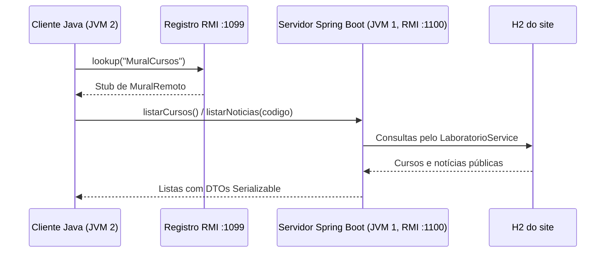

# Java RMI no mural dos cursos

O projeto publica duas consultas por RMI: `listarCursos()` e `listarNoticias(codigoCurso)`.
O cliente Java executa em outra JVM e recebe cópias serializadas dos dados públicos do mural.
O site continua usando o mesmo H2 e as mesmas regras para login, contas, notícias e CWP.

## Fluxo



## Arquivos para estudar

| Arquivo no pacote `br.edu.bcc.autorizacao.rmi` | Responsabilidade |
| --- | --- |
| `MuralRemoto.java` | Interface que estende `Remote`; os métodos declaram `RemoteException`. |
| `DadosMural.java` | Records `Curso` e `Noticia` que implementam `Serializable`. |
| `ServicoMuralRmi.java` | Implementação que consulta os dados atuais pelo serviço do site. |
| `ServidorRmi.java` | Cria o registro, exporta o objeto e associa o stub ao nome `MuralCursos`. Libera os objetos ao encerrar. |
| `ClienteRmi.java` | Programa com `main`, faz `lookup` e chama a interface remota. |

O código interno `aurora` corresponde a Ciência da Computação, `verde` a Física e
`horizonte` a Matemática. Código vazio ou `null` consulta todas as notícias;
um código inexistente é recusado. As consultas retornam somente os dados públicos:
contas, credenciais, vínculos e histórico administrativo continuam na área autenticada do site.

## Executar em dois terminais

Na pasta `atividadelabautorizacao`, gere os artefatos:

```bash
mvn package
```

No primeiro terminal, inicie o servidor:

```bash
java -jar target/laboratorio-autorizacao-1.0.0.jar
```

Se o projeto já estiver rodando, encerre a instância anterior antes de iniciar a nova.
O H2 em arquivo é aberto somente pelo servidor; o cliente RMI não precisa do banco.
O NetBeans também inicia o servidor com **Executar Projeto**, usando o `nbactions.xml` existente.

O site abre em `http://localhost:8081`; o log informa `RMI disponível em 127.0.0.1:1099/MuralCursos`.
O próprio aplicativo cria o registro: não é necessário iniciar `rmiregistry` separadamente.

No segundo terminal, consulte o mural:

```bash
java -jar target/laboratorio-autorizacao-1.0.0-cliente-rmi.jar
java -jar target/laboratorio-autorizacao-1.0.0-cliente-rmi.jar 127.0.0.1 1099 aurora
java -jar target/laboratorio-autorizacao-1.0.0-cliente-rmi.jar 127.0.0.1 1099 verde
java -jar target/laboratorio-autorizacao-1.0.0-cliente-rmi.jar 127.0.0.1 1099 horizonte
```

O JAR `cliente-rmi` contém apenas o contrato, os DTOs e o programa cliente.
Pode ser copiado para outra pasta e executado com Java 17 ou superior, sem Maven ou Spring.
`--help` mostra os argumentos. O código de saída é `0` em sucesso, `1` em falha de
comunicação/registro e `2` para argumento ou curso inválido.

## Configuração

| Variável | Padrão | Função |
| --- | --- | --- |
| `RMI_ENABLED` | `true` | Ativa o servidor RMI. `false` executa somente o site. |
| `RMI_HOST` | `127.0.0.1` | Endereço de escuta e endereço anunciado pelo stub. |
| `RMI_PORT` | `1099` | Porta do registro de nomes. |
| `RMI_SERVICE_PORT` | `1100` | Porta das chamadas ao objeto remoto. |
| `PORT` | `8081` | Porta HTTP do site. |

Exemplo com outras portas:

```bash
RMI_PORT=2099 RMI_SERVICE_PORT=2100 java -jar target/laboratorio-autorizacao-1.0.0.jar
java -jar target/laboratorio-autorizacao-1.0.0-cliente-rmi.jar 127.0.0.1 2099
```

Para demonstrar entre duas máquinas da rede local, configure `RMI_HOST` com o IP
da máquina servidora, como `192.168.1.10`, e passe esse IP ao cliente. As duas portas
RMI precisam ser alcançáveis. O padrão usa somente a interface local.

Se o servidor não iniciar por porta ocupada, encerre a outra instância ou altere as
duas portas. Se o cliente informar falha de conexão, confira o log de inicialização,
o endereço e a porta do registro. Para uma execução sem RMI, use `RMI_ENABLED=false`.

## Demonstração para a disciplina

1. Abra o mural no navegador e execute o cliente no segundo terminal.
2. Mostre que ambos apresentam os três cursos e suas notícias.
3. Entre no site como `carlos` em Ciência da Computação e publique uma notícia.
4. Execute o cliente com `aurora`: a publicação aparece na chamada remota seguinte.
5. Execute com `verde` ou `horizonte`: aparecem as notícias do curso selecionado.
6. Encerre o servidor e execute o cliente: ele informa a falha de comunicação e termina com código `1`.

O navegador usa HTTP. A demonstração RMI ocorre entre o programa cliente Java e o
servidor, sem uma chamada HTTP intermediária.

## Testes

`mvn test` executa a suíte do site e `MuralRmiIntegrationTest`. Os testes RMI fazem
`lookup` em um registro real e chamadas pelo stub, usando portas livres e H2 em memória.
Verificam serialização dos DTOs, filtro por curso, código inexistente, dados atualizados,
execução do cliente e encerramento/reabertura do registro. O banco em `data/` fica fora dos testes.

## Relação com as referências

A estrutura segue o [tutorial RMI da Oracle](https://docs.oracle.com/javase/tutorial/rmi/index.html)
e o PDF local **Tutorial RMI - Remote Method Invocation - DevMedia**: contrato remoto,
implementação, registro de nomes e cliente que obtém o stub.

A implementação usa `LocateRegistry.createRegistry`, `UnicastRemoteObject.exportObject`
e `Registry.lookup`. Os stubs são gerados dinamicamente, conforme a
[API de UnicastRemoteObject do Java 17](https://docs.oracle.com/en/java/javase/17/docs/api/java.rmi/java/rmi/server/UnicastRemoteObject.html).
Os tutoriais antigos devem ser lidos junto com a API atual; esta implementação não depende
de geração de stubs por `rmic` nem de instalação de `SecurityManager`.
